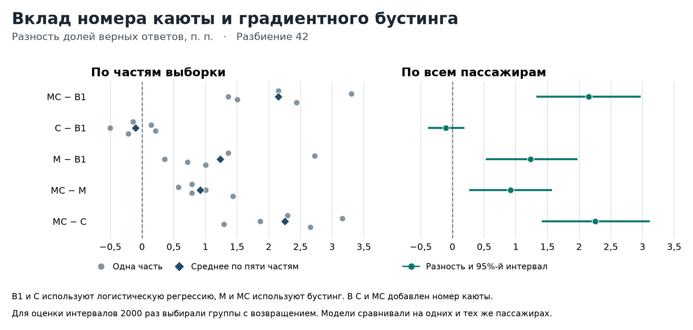

# ДЗ2. Номер каюты и градиентный бустинг

**На основном разбиении доля верных ответов выросла с 78,803 % у логистической регрессии из ДЗ1 до 80,956 % у бустинга с номером каюты.** На тех же 6968 пассажирах бустинг исправил 476 ошибок регрессии и допустил 326 новых. Бустинг с номером каюты оказался точнее остальных трёх моделей при каждом разбиении.

## Что проверяли

В ДЗ1 мы предсказывали с помощью логистической регрессии, переместился ли пассажир в другое измерение. У переместившихся пассажиров поле `Transported` соответствует классу 1. Добавление палубы и борта каюты повысило долю верных ответов. Регрессия с высокой уверенностью ошиблась, в частности, в двух случаях. Один пассажир находился в криосне, у другого были большие расходы. В ДЗ2 мы проверили, улучшат ли прогноз деревья, которые могут учитывать разные пороги расходов для разных групп пассажиров. Второй вопрос касался номера каюты. Помогает ли он предсказать исход, когда палуба и борт уже известны? Для сравнения взяли логистическую регрессию и градиентный бустинг. Обе модели проверили с номером каюты и без него. [Гипотезы и план](docs/HW2_PLAN.md) · [Результаты ДЗ1](docs/CONCLUSIONS.md)

## Журнал экспериментов

При каждом разбиении мы распределяли группы пассажиров по пяти частям (фолдам). Все пассажиры одной группы попадали в одну часть. По очереди оставляли одну часть для проверки, а по остальным четырём обучали модель. Столбцы 42, 17 и 2026 соответствуют начальным значениям генератора случайных чисел. Для каждого разбиения указана средняя доля верных ответов по пяти фолдам в процентах. На основном разбиении (42) мы выбирали модель, на двух других проверяли, сохранится ли её преимущество. Для основного разбиения также указаны выборочное стандартное отклонение по фолдам и логарифмические потери по всем проверочным прогнозам. Чем меньше потери, тем лучше модель оценивает вероятности.

| Вариант | Модель | 42 | Ст. откл., п. п. | 17 | 2026 | Логарифмические потери (42) |
| --- | --- | ---: | ---: | ---: | ---: | ---: |
| B1 | Логистическая регрессия из ДЗ1 | 78,803 | 0,778 | 78,660 | 78,674 | 0,4395 |
| C | Та же регрессия с номером каюты | 78,703 | 0,779 | 78,602 | 78,875 | 0,4387 |
| M | Бустинг на признаках B1 | 80,037 | 1,400 | 80,123 | 79,707 | 0,4108 |
| MC | Бустинг с номером каюты | **80,956** | 1,179 | **80,454** | **80,583** | **0,3859** |

Каждый из четырёх вариантов мы обучили 15 раз. При обучении на 5574 пассажирах для проверки оставались 1394, а при обучении на 5575 пассажирах оставались 1393. Все 60 запланированных запусков прошли в один поток. Позднее мы провели ещё 10 запусков, чтобы проверить бустинг на новых диапазонах номеров групп. Медианное время одного обучения составило 0,040 с для B1, 0,046 с для C, 0,311 с для M и 0,325 с для MC. Время указано для одного компьютера. [Время обучения по фолдам](reports/hw2/metadata.json) · [Дополнительная проверка по диапазонам](reports/hw2/cabin_blocks.csv)

В B1 и C использовали логистическую регрессию с L2-регуляризацией и параметром `C = 1`. Чем меньше `C`, тем сильнее штраф за большие коэффициенты. В основном сравнении бустинг обучили 30 раз, по 150 деревьев в каждом запуске, всего 4500 деревьев. Каждое следующее дерево уточняет прогноз так, чтобы уменьшить логарифмические потери. Шаг обучения равен 0,08. Дерево может иметь до 15 листьев, в каждом должно быть не менее 20 обучающих примеров. [Параметры регрессии](configs/baseline.yaml) · [Параметры бустинга](configs/hw2.yaml) · [Метрики всех 60 запусков](reports/hw2/folds.csv)

## Что показали абляции

Чтобы оценить вклад каждого изменения, мы сравнили полную модель MC с двумя вариантами. В варианте M убрали номер каюты. В варианте C сохранили номер и заменили бустинг логистической регрессией. Долю верных ответов сравнивали на каждом фолде основного разбиения, затем усредняли разности. Интервал для разности оценивали по прогнозам для всех пассажиров вместе.

| Что изменили в MC | Сравнение | Средняя разность, п. п. | Фолды с преимуществом MC | Условный 95%-й интервал, п. п. |
| --- | --- | ---: | ---: | ---: |
| Убрали номер каюты | MC − M | +0,919 | 5 из 5 | от +0,262 до +1,573 |
| Заменили бустинг регрессией | MC − C | +2,253 | 5 из 5 | от +1,410 до +3,117 |

**Номер каюты.** Бустинг с номером каюты исправил 294 ошибки варианта без номера и допустил 230 новых. При пороге 0,5 ложноположительных ответов стало на 131 меньше (646 вместо 777), а число ложноотрицательных выросло на 67 (с 614 до 681). В итоге модель дала на 64 верных ответа больше. На разбиениях 17 и 2026 номер также повысил среднюю долю верных ответов у бустинга на 0,330 и 0,876 п. п. соответственно.

В логистической регрессии вклад номера каюты в логарифм шансов линейный. На основном разбиении регрессия с номером исправила 48 ошибок и допустила 55 новых. На разбиении 17 доля верных ответов у регрессии с номером тоже снизилась, а на разбиении 2026 выросла. Интервал для разности C − B1 на основном разбиении включает ноль (от −0,386 до +0,189 п. п.). Устойчивого выигрыша от номера у регрессии мы не обнаружили. Возможное объяснение в том, что дерево может использовать разные пороги номера каюты на разных палубах.

**Бустинг.** На исходных признаках замена регрессии бустингом повысила среднюю долю верных ответов на 1,234 п. п. С номером каюты бустинг опередил B1 на 2,153 п. п. По сравнению с B1 число ложноположительных ответов у MC сократилось с 790 до 646, а число ложноотрицательных уменьшилось с 687 до 681. Из 150 дополнительных верных ответов 144 пришлись на пассажиров класса 0. [Парные сравнения и число исправленных и новых ошибок](reports/hw2/ablations.csv)

**Зависит ли польза номера от модели?** Затем мы сравнили, насколько добавление номера каюты улучшило прогноз у бустинга и у регрессии. Разность прибавок считали по формуле (MC − M) − (C − B1). На разбиении 42 разность была положительной на всех пяти фолдах и составила в среднем +1,019 п. п. По объединённым прогнозам четырёх моделей условный 95%-й интервал для этой разности составил от +0,301 до +1,718 п. п. При расчёте интервала для всех четырёх моделей мы каждый раз брали одни и те же группы пассажиров. На разбиениях 17 и 2026 средняя разность также была положительной (+0,387 и +0,675 п. п.). На этих данных номер каюты больше помог бустингу. [Результаты по фолдам](reports/hw2/interaction.csv)



## Что стало с ошибками из ДЗ1

На основном разбиении бустинг M дал на 86 верных ответов больше, чем регрессия B1 на тех же признаках. В таблице приведены результаты отдельно для пассажиров в криосне, без криосна и с пропуском в этом поле. [Результаты для всех трёх разбиений](reports/hw2/hw1_errors.csv)

| Криосон | Пассажиры | Верных ответов у B1 | Верных ответов у M | Изменение доли верных ответов, п. п. |
| --- | ---: | ---: | ---: | ---: |
| Нет | 4345 | 3362 | 3443 | +1,86 |
| Да | 2446 | 1987 | 1996 | +0,37 |
| Не указан | 177 | 142 | 138 | −2,26 |

При всех трёх разбиениях больше всего верных ответов прибавилось у пассажиров без криосна. В ДЗ1 мы отдельно отобрали самый уверенный ложноположительный прогноз B1 и самый уверенный ложноотрицательный. На обоих примерах бустинг тоже ошибся. Для пассажира `7219_02` из класса 0 вероятность класса 1 выросла с 0,989 у B1 до 0,992 у M. Для пассажира `1182_02` из класса 1 она выросла лишь с 0,007 до 0,015. Обе модели с номером каюты также ошиблись в этих двух случаях.

Третий пример из ДЗ1 относится к пассажиру `2822_02` с тремя пропусками в записи. Его истинный класс равен 0. Только MC дала верный ответ, оценив вероятность класса 1 в 0,394 при пороге 0,5. У B1, C и M значения лежали в диапазоне от 0,582 до 0,675. [Примеры, отобранные в ДЗ1](reports/error_examples.json) · [Прогнозы по пассажирам](reports/hw2/predictions.csv.gz)

## Какую информацию несёт номер каюты

После выбора MC мы сравнили два варианта бустинга на каждой палубе отдельно. На основном разбиении номер дал 64 дополнительных верных ответа. На палубе F бустинг с номером каюты дал на 28 верных ответов больше, чем без него, а на палубе G выигрыш составил 41 ответ. У остальных пассажиров, включая тех, для кого каюта не указана, верных ответов стало на 5 меньше. На разбиениях 17 и 2026 основная прибавка также пришлась на палубы F и G.

| Палуба | Пассажиры | Доля класса 1, % | AP без номера | AP с номером | Изменение числа верных ответов |
| --- | ---: | ---: | ---: | ---: | ---: |
| F | 2265 | 43,84 | 0,898 | 0,908 | +28 |
| G | 2046 | 51,03 | 0,700 | 0,810 | +41 |
| E | 692 | 36,42 | 0,753 | 0,749 | −8 |
| Каюта не указана | 164 | 49,39 | 0,890 | 0,890 | +3 |

Средняя точность (average precision, AP) показывает, насколько высоко модель ставит пассажиров класса 1 при ранжировании по предсказанной вероятности. AP зависит от доли этого класса, поэтому мы сравниваем модели в пределах одной палубы. На палубе G сильнее всего выросли и AP, и число верных ответов. На палубе E оба показателя несколько снизились. На палубе T всего пять пассажиров, лишь один из них относится к классу 1. [Результаты по всем палубам и разбиениям](reports/hw2/cabin_errors.csv)

У 6804 пассажиров рабочей выборки указана каюта. На каждой палубе мы рассмотрели левый и правый борта отдельно. Если у нескольких пассажиров совпадали и номер каюты, и номер группы, эту пару учитывали один раз. Для 15 сочетаний палубы и борта оказалось возможным сравнить несколько групп. Во всех 15 случаях ранги номеров кают совпали с рангами номеров групп. Для шестнадцатого сочетания в данных был только один пассажир. Модель не получает идентификатор пассажира (`PassengerId`) напрямую, но по номеру каюты можно судить о порядке групп. Поскольку на основном разбиении соседние по номеру группы могут оказаться и среди обучающих, и среди проверочных, выигрыш может быть связан как с расположением кают, так и с порядком нумерации групп. [Сопоставление рангов номеров кают и групп](reports/hw2/cabin_order.csv)

**Проверка на новых диапазонах номеров.** Обнаружив эту связь, мы упорядочили 4986 групп по номеру и разделили их на пять последовательных диапазонов по 997 или 998 групп. Каждый диапазон по очереди оставляли для проверки, а на остальных четырёх обучали модели M и MC. Для этих десяти дополнительных запусков использовали те же настройки бустинга. К этой проверке перешли после выбора MC.

| Проверочный диапазон номеров групп | Пассажиры | Верных ответов у M, % | Верных ответов у MC, % | Вклад номера каюты, п. п. |
| --- | ---: | ---: | ---: | ---: |
| 1…1871 | 1410 | 77,38 | 77,38 | 0,00 |
| 1872…3688 | 1348 | 78,19 | 79,01 | +0,82 |
| 3692…5540 | 1387 | 80,39 | 80,25 | −0,14 |
| 5543…7379 | 1430 | 80,98 | 83,43 | +2,45 |
| 7385…9280 | 1393 | 79,11 | 79,83 | +0,72 |

В среднем по пяти диапазонам номер каюты повысил долю верных ответов на **0,767 п. п.** На всей рабочей выборке MC исправила 334 ошибки модели M и допустила 280 новых. Из 54 дополнительных верных ответов 35 пришлись на диапазон 5543…7379. В первом диапазоне обе модели дали одинаковое число верных ответов, а в третьем MC немного уступила M. Таким образом, выигрыш на новых диапазонах зависит от того, какие номера групп попали на проверку. Отделить влияние расположения кают от влияния порядка групп этот опыт не позволяет. [Метрики и состав выборок по диапазонам](reports/hw2/cabin_blocks.csv) · [Прогнозы обеих моделей](reports/hw2/cabin_block_predictions.csv.gz)

## Как сравнивали модели

Как и в ДЗ1, модель оценивает вероятность класса 1 для одного пассажира и присваивает ему этот класс при вероятности от 0,5. Перед обучением скрипт сверяет контрольные суммы исходного CSV и файла с распределением пассажиров по фолдам. При каждом обучении целые группы попадают либо в обучающую, либо в проверочную часть. Все признаки относятся к самому пассажиру. Номер каюты берём из средней части поля `Cabin`. Если поле пустое или запись не соответствует формату, номер считаем пропущенным. Пропуски в числовых признаках заполняем медианами обучающей части. По ней же рассчитываем параметры масштабирования и определяем, какие категории представить отдельными двоичными признаками. Для каждого пассажира при каждом разбиении сверяем прогноз B1 с архивом ДЗ1 по вероятности, предсказанному классу и номеру фолда. [Код эксперимента](src/spaceship_hw2.py) · [Метаданные запусков](reports/hw2/metadata.json)

Интервалы оценивали по готовым проверочным прогнозам. Мы 2000 раз случайно выбирали с возвращением целые группы и в каждом повторе сравнивали модели на одних и тех же пассажирах. Эти интервалы характеризуют разброс оценок для уже обученных моделей. Все три разбиения содержат одних и тех же пассажиров. Поскольку лучшую модель мы выбирали по средней доле верных ответов, оценка её качества на тех же данных может быть завышена. Для итоговой проверки в конце курса оставили 1725 пассажиров. Все решения в ДЗ2 принимали по рабочей выборке. Файл `test.csv` и оценки в таблице результатов Kaggle при выборе и сравнении моделей не использовали.

**Выбор для следующей работы.** По критерию ДЗ1 выбрали бустинг с номером каюты (MC). В ДЗ3 стоит проверить, сохранится ли его преимущество, если изменится доля пассажиров с палуб F и G. Именно на этих палубах добавление номера дало основную прибавку.

## Как повторить расчёты

Выполните команды из корня репозитория на Linux. В эксперименте использовали Python 3.14 и те же версии библиотек, что и в ДЗ1.

```bash
python -m venv .venv
.venv/bin/python -m pip install -r requirements.txt
./scripts/run_hw2.sh
.venv/bin/python -m pytest -q
```

Скрипт `run_hw2.sh` сохраняет в `reports/hw2/` прогнозы, метрики и рисунок, строит таблицы по палубам и проверяет модели на новых диапазонах номеров групп. Чтобы сохранить результаты в отдельной папке, выполните `./scripts/run_hw2.sh --output comparison-results`. [Проверочные прогнозы](reports/hw2/predictions.csv.gz) · [Сводная таблица](reports/hw2/summary.csv) · [Задание ДЗ2](https://github.com/PikaChuChuMF/RnD-ML-Course-2026-2/blob/main/HW_2/HomeWork_2.md)

При повторном запуске из чистой копии репозитория файл с 83 616 проверочными прогнозами, таблицы и рисунок побайтно совпали с исходными. Все 20 904 прогноза B1 по трём разбиениям совпали с архивом ДЗ1.
