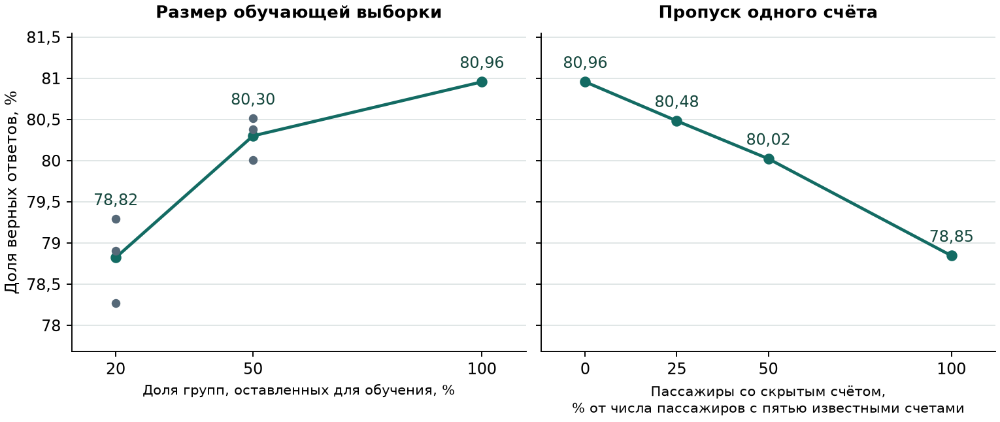
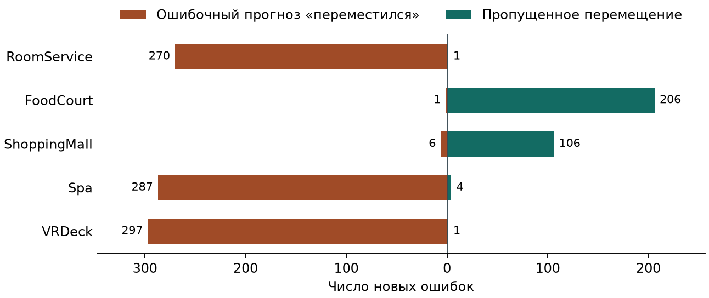

# ДЗ3. Где ошибается модель Spaceship Titanic

Модель предсказывает, переместился ли пассажир в другое измерение. Средняя доля верных ответов составила **80,96%**. Среди пассажиров без криосна, у которых известны все пять счетов и больше половины расходов пришлось на Spa и VRDeck, модель выявила лишь **12 из 142 перемещений**. Если у каждого пассажира с пятью известными счетами скрыть один случайно выбранный счёт, ожидаемая точность по всей выборке снизится до **78,80%**.

## Модель и проверочные данные

В ДЗ2 сравнивали четыре основные модели. На всех трёх разбиениях больше всего верных ответов дал градиентный бустинг с номером каюты (MC). При добавлении доли расходов на питание и покупки точность на основном разбиении выросла на 0,37 п. п., но 95%-й интервал включал ноль (от −0,16 до +0,91 п. п.). Для разбора ошибок выбрали MC. Оба варианта сравнили по палубам и у пассажиров с пропусками в счетах. [Журнал экспериментов ДЗ2](HW2.md#журнал-экспериментов) · [Опыт с составом расходов](HW2.md#помогает-ли-состав-расходов)

В модели 150 деревьев, в каждом до 15 листьев. Шаг обучения равен 0,08. Для прогноза использовали сведения о пассажире, расположение каюты и расходы на пять услуг. Для каждого числового признака пропуски заполняли его медианой по обучающей выборке. В категориальных признаках для пропусков выделили отдельную категорию. При вероятности перемещения 0,5 и выше модель отвечает «переместился». [Конфигурация](configs/hw2.yaml) · [Предобработка](src/spaceship_hw1/features.py)

В рабочей выборке ДЗ2 было 6 968 пассажиров из 4 986 групп бронирования. Группы распределили целиком по пяти частям (`seed=42`). Каждую часть по очереди использовали для проверки, а на остальных четырёх обучали модель. Средняя доля верных ответов по пяти частям составила 80,956%. Модель пропустила 681 из 3 501 перемещения. Ещё у 646 пассажиров она предсказала перемещение ошибочно. [Проверочные прогнозы](reports/hw2/predictions.csv.gz)

## Четыре типичные ошибки

В каждой строке показан ошибочный прогноз с оценкой вероятности, ближайшей к медиане среди ошибок этого типа. Для сравнения в той же проверочной части искали пассажира, которому модель дала такой же, но верный ответ. Помимо условий в строке должны были совпасть палуба, планета вылета и набор пропущенных счетов. Из подходящих прогнозов брали ближайший по вероятности. Единица означает «переместился», ноль означает «остался». [Примеры для сравнения](reports/hw3/errors.csv)

| Условия | Пассажир | Вероятность перемещения | Прогноз / факт | Ошибок среди таких прогнозов |
|---|---|---:|:---:|---:|
| Криосон на G, все счета нулевые | `6128_01` | 0,608 | 1 / 0 | 244 из 785 (31,1%) |
| Без криосна, все счета нулевые | `5714_02` | 0,393 | 0 / 1 | 49 из 141 (34,8%) |
| Без криосна, известны все пять счетов, на Spa и VRDeck пришлось больше половины расходов | `1892_01` | 0,126 | 0 / 1 | 130 из 1 255 (10,4%) |
| Без криосна, хотя бы один счёт отсутствует | `3704_01` | 0,639 | 1 / 0 | 45 из 110 (40,9%) |

**Криосон на G.** Пассажирам `6128_01` и `6175_02` с Земли было 23 и 21 год. Номера их кают на палубе G различались на восемь (G/992/P и G/1000/P). Для обоих модель оценила вероятность перемещения в 0,60786. Переместился только второй. Всего в этой проверочной части модель дала такую оценку пяти пассажирам палубы G из разных групп бронирования. Двое переместились, трое остались.

**Нулевые расходы без криосна.** У двух детей из каюты G/916/P различался только возраст. Для четырёхлетнего пассажира `5714_01` модель оценила вероятность перемещения в 0,561, для двенадцатилетнего `5714_02` в 0,393. Переместился только старший, так что оба прогноза ошибочны. Среди детей не старше 12 лет без криосна, у которых все пять счетов равны нулю, нашлось 29 пар в 27 группах бронирования. В каждой паре совпадали каюта и все остальные признаки, кроме возраста. В девяти парах ответы различались. Во всех девяти модель предсказала перемещение младшему. В пяти из этих пар переместился только старший ребёнок, в одной только младший, а в трёх исход был одинаковым для обоих. В этих парах возраст объясняет, почему модель дала разные ответы. [Все пары](reports/hw3/child_age_pairs.csv)

**Расходы на Spa и VRDeck.** Пассажир `1892_01` потратил на эти услуги 1 040 из 1 854 и переместился вопреки прогнозу. Для 1 255 из 1 275 пассажиров этой группы модель дала ответ «остался». Из этих ответов ошибочны 10,4%. В то же время **модель пропустила 130 из 142 перемещений (91,5%)**. Большинство людей в группе остались на месте, поэтому даже постоянный ответ «остался» дал бы 88,9% верных прогнозов. Модель дала 89,2%. [Данные по четырём типам ошибок](reports/hw3/errors.csv)

**Неизвестная сумма за Spa.** Для `3704_01` не нашлось похожего пассажира с верным прогнозом. Проверили, при какой сумме за Spa модель изменит ответ. В обучающей выборке нашли 904 пассажира с Земли, летевших на палубе F без криосна. У всех известны пять счетов. Перебрали все 333 суммы, которые встречались у них в счёте за Spa. При сумме 52 вероятность перемещения равна 0,520, при 53 она снижается до 0,478. Если по очереди подставить пассажиру `3704_01` счёт каждого из 904 человек, в 326 случаях модель исправит ошибку, в остальных 578 сохранит прежний ответ. [Все суммы и ответы](reports/hw3/spa_case.csv)

Всего модель предсказала перемещение 26 пассажирам без криосна, у которых отсутствовал только счёт за Spa. У одного неизвестна планета вылета. Для остальных 25, включая `3704_01`, нашлись пассажиры для сравнения по тем же условиям. Исходный прогноз был верен для 16 человек (64,0%). Если для каждого из 25 взять счёт за Spa у случайно выбранного похожего пассажира из обучающей выборки, в среднем удастся исправить 3,02 ошибки, но появится 3,79 новых. При такой замене ожидаемая точность в этой группе снижается до **60,9%**. Фактические суммы по пропущенным счетам неизвестны. [Расчёт для каждого пассажира](reports/hw3/spa_case_controls.csv)

На эти четыре типа пришлось 468 из 1 327 ошибок. Для четырёх пассажиров из таблицы прогноз остался ошибочным и на двух других разбиениях. Во всей выборке нашлись три пары пассажиров, у которых совпадают все 11 исходных признаков, включая пропуски, но в каждой паре переместился только один. Так, у двух трёхлетних детей из каюты G/1368/P модель оценила вероятность перемещения одинаково (0,53311). Правило, которое даёт одинаковый ответ при одинаковых признаках, ошибётся хотя бы у одного пассажира из каждой пары. Проверить их исходы по независимому источнику мы не можем. [Шесть записей и их прогнозы](reports/hw3/identical_inputs.csv)

## Качество по палубам и состоянию счетов

На палубу G пришлось 29,4% пассажиров и 44,8% ошибок. Среди пассажиров с известной планетой вылета все 593 человека на палубе B летели с Европы, а все 2 005 на палубе G с Земли. По этим двум палубам нельзя отделить влияние палубы от влияния планеты вылета. На палубе T верны все пять ответов, но пяти наблюдений мало для общего вывода. [Все палубы](reports/hw3/slices.csv) · [Планеты вылета](reports/hw3/deck_origins.csv)

Для палуб F и G сравнили долю верных ответов как в целом, так и среди пассажиров с Земли без криосна. Чтобы получить 95%-е доверительные интервалы, 2 000 раз случайно выбирали с возвращением целые группы бронирования (`seed=9187`). В каждом повторе использовали уже полученные прогнозы.

| Пассажиры | Палуба F | Палуба G | Разность F минус G, п. п. | 95%-й интервал, п. п. |
|---|---:|---:|---:|---:|
| Все | 1 902/2 265 (83,97%) | 1 452/2 046 (70,97%) | +13,01 | от +10,68 до +15,59 |
| С Земли без криосна | 986/1 260 (78,25%) | 690/890 (77,53%) | +0,73 | от −2,61 до +4,25 |
| Из них переместившиеся | 173/355 (48,73%) | 179/311 (57,56%) | −8,82 | от −15,83 до −0,83 |
| Из них оставшиеся | 813/905 (89,83%) | 511/579 (88,26%) | +1,58 | от −1,70 до +4,97 |

Среди пассажиров с Земли без криосна на палубе F переместились 28,2%, на G 34,9%. Если принять для обеих палуб общую долю переместившихся (666 из 2 150), расчётная точность составит 77,10% на F и 78,75% на G. Разность **−1,64 п. п.** с интервалом от −4,71 до +1,59 п. п. не позволяет уверенно сказать, на какой палубе модель точнее. На F модель пропустила больше половины перемещений среди пассажиров с Земли без криосна. Эти группы пассажиров выделили после просмотра ошибок. [Расчёт долей и интервалов](reports/hw3/deck_comparisons.csv)

| Состояние пяти счетов | Пассажиров | Из них переместились | Точность | Ошибочно предсказано / пропущено перемещений |
|---|---:|---:|---:|---:|
| Все известны, есть расходы | 3 620 | 1 093 (30,2%) | 82,15% | 195 / 451 |
| Все известны и равны нулю | 2 622 | 2 045 (78,0%) | 80,24% | 364 / 154 |
| Хотя бы один отсутствует | 726 | 363 (50,0%) | 77,55% | 87 / 76 |

При пропусках в счетах точность ниже, но различается и доля переместившихся. Влияние самого пропуска проверили отдельно, скрывая известные суммы у тех же пассажиров. У 726 пассажиров с пропусками вариант модели с долей расходов на питание и покупки исправил 37 ошибок исходной модели и допустил 29 новых. Среди всех пассажиров палубы F верных ответов стало на 26 больше (65 исправлений, 39 новых ошибок), а на G их стало на 13 меньше (69 исправлений, 82 новые ошибки). [Сравнение двух моделей](reports/hw3/slices.csv)

## Две проверки устойчивости

**1. Как точность зависит от числа групп в обучающей выборке?** Проверочные части оставили прежними. В каждой обучающей части перемешали группы и взяли первые 20%, первые 50% или все группы. При долях 20% и 50% провели по три опыта с разным порядком групп (начальные значения генератора 101, 202 и 303). Каждый раз заново рассчитывали параметры обработки признаков и обучали деревья. При обучении на всех группах расхождение с прогнозами ДЗ2 не превысило `1e-9` ни для одной из 6 968 вероятностей.

| Доля групп в обучении | Средняя точность | Точность в трёх повторах |
|---|---:|---:|
| 100% | 80,96% | Один расчёт на всех группах |
| 50% | 80,30% | от 80,01 до 80,51% |
| 20% | 78,82% | от 78,27 до 79,29% |

При сокращении числа групп вдвое средняя точность снизилась на 0,66 п. п. Даже лучший результат при 20% групп оказался ниже худшего при 50%. [Результаты по проверочным частям и повторам](reports/hw3/robustness_folds.csv)

**2. Как изменится прогноз, если пропадёт один счёт?** У 6 242 пассажиров известны все пять сумм. По хешу идентификатора определили порядок этих пассажиров и выбрали для каждого один счёт. Сначала скрыли выбранный счёт у первых 25% пассажиров в этом списке, затем у первых 50% и, наконец, у всех. Точность каждый раз считали по всем 6 968 пассажирам, включая 726 человек, у которых изначально были пропуски. Во всех трёх случаях использовали те же обученные модели.

| Доля записей с новым пропуском среди 6 242 полных | Новых пропусков | Точность на всей выборке | Исправленные / новые ошибки |
|---|---:|---:|---:|
| 0% | 0 | 80,96% | 0 / 0 |
| 25% | 1 560 | 80,48% | 21 / 54 |
| 50% | 3 121 | 80,02% | 40 / 105 |
| 100% | 6 242 | 78,85% | 82 / 229 |



Затем для тех же 6 242 пассажиров перебрали все пять вариантов пропуска. Это позволяет рассчитать ожидаемую точность, если у каждого независимо пропадёт один случайно выбранный счёт и все пять вариантов равновероятны. Средняя точность по пяти проверочным частям составила бы **78,80%**. По всей выборке доля верных ответов снизилась бы на 2,16 п. п. (95%-й интервал от 1,92 до 2,40 п. п. при повторном отборе групп бронирования). Пропуск нулевого счёта ни разу не изменил прогноз. Медиана по каждой услуге в обучающих выборках равнялась нулю, поэтому при заполнении пропуска восстанавливалась исходная сумма. [Общие результаты](reports/hw3/robustness.csv) · [Результаты по пяти услугам](reports/hw3/bill_services.csv)

Когда скрыли расходы на Spa, появилась 291 новая ошибка. В 287 случаях модель предсказала перемещение тем, кто остался. Пропуск расходов на FoodCourt привёл к 207 новым ошибкам. В 206 случаях модель пропустила перемещение. В обоих опытах снизилась ROC-AUC. Это означает, что по оценкам вероятности стало труднее отличить переместившихся от оставшихся.



| Данные о расходах | Предсказано перемещений при пороге 0,5 | ROC-AUC | Точность при пороге 0,5 | Наибольшая точность при подборе порога |
|---|---:|---:|---:|---:|
| Исходные записи | 3 466 | 0,9018 | 80,96% | 81,54% |
| Без суммы за Spa | 3 820 | 0,8705 | 77,91% | 78,90% |
| Без суммы за FoodCourt | 3 175 | 0,8887 | 79,33% | 80,09% |

ROC-AUC и точность усреднили по пяти проверочным частям. Для последнего столбца использовали известные исходы и в каждой части выбрали порог с наибольшей долей верных ответов. Это верхняя граница точности для этих прогнозов. Даже при таком выборе порога при пропуске счёта за Spa или FoodCourt точность осталась ниже исходных 80,96%. [Оценки для всех услуг](reports/hw3/bill_scores.csv)

## Применимость и риски

Достаточно ли перепроверять прогнозы с низкой уверенностью? Уверенностью здесь называем вероятность того исхода, который предсказала модель. На основном разбиении у 1 633 пассажиров она была ниже 0,65. На эту группу пришлось 730 из 1 327 ошибок. В неё же попали 540 из 588 пассажиров, у которых ответ модели зависел от разбиения. У 3 043 пассажиров уверенность на основном разбиении составила не менее 0,90. Для каждого из них модель дала один и тот же ответ на всех трёх разбиениях и **у 107 человек ошиблась все три раза**. Проверка только прогнозов с низкой уверенностью оставит эти ошибки незамеченными. [Ошибки и смена ответа по разбиениям](reports/hw3/confidence.csv)

Результаты относятся к новым группам бронирования из того же источника данных. В 15 сочетаниях палубы и борта порядок номеров кают совпал с порядком номеров групп. Если каюты начнут нумеровать иначе, номер каюты может оказаться менее полезным для прогноза. Мы не проверяли, как изменится точность, если пропадут сразу несколько счетов или если чаще будут пропадать крупные суммы. Идентификатор пассажира не входит в признаки модели. Для независимой итоговой проверки отложили данные ещё о 1 725 пассажирах. [Нумерация кают](reports/hw2/cabin_order.csv) · [Разбиение](data/splits/manifest.json)

## Как повторить

Запуск проверен в Linux с Python 3.14. Выполните команды из корня проекта.

```bash
python -m venv .venv
.venv/bin/python -m pip install -r requirements.txt
./scripts/run_hw3.sh
.venv/bin/python -m pytest -q
```

Скрипт при необходимости загружает исходный файл, проверяет его контрольную сумму и сохраняет таблицы и рисунки в `reports/hw3/`. Чтобы сравнить их с результатами повторного расчёта, задайте для него пустую папку с помощью `--output`. [Условие ДЗ3](https://github.com/PikaChuChuMF/RnD-ML-Course-2026-2/blob/main/HW_3/HomeWork_3.md)
