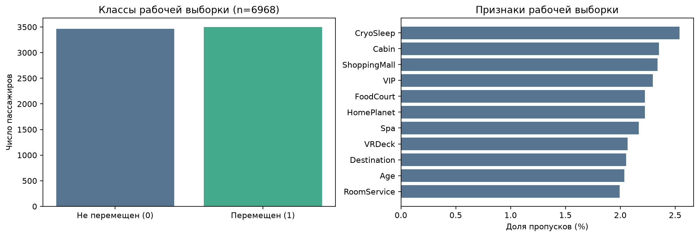
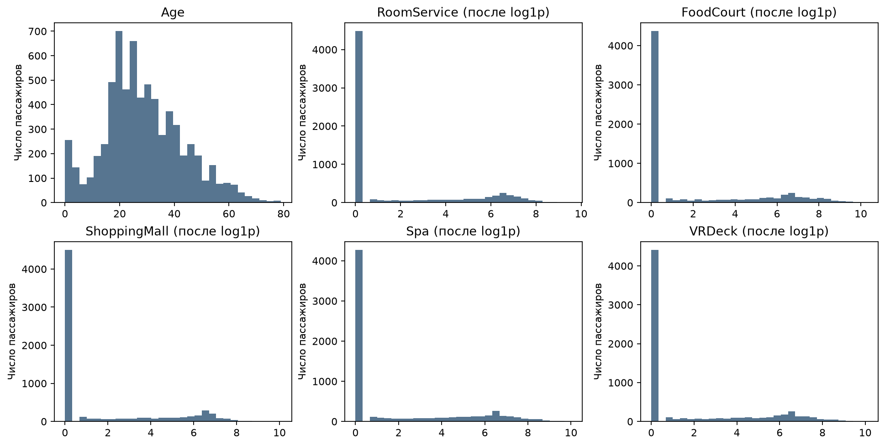
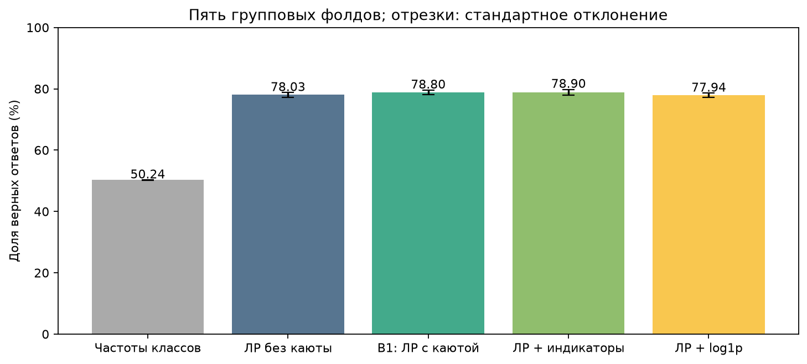
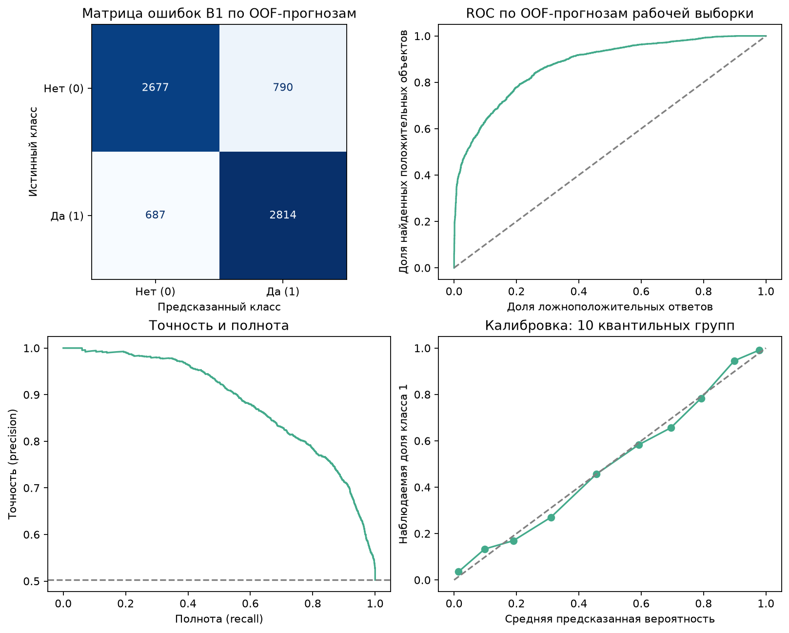
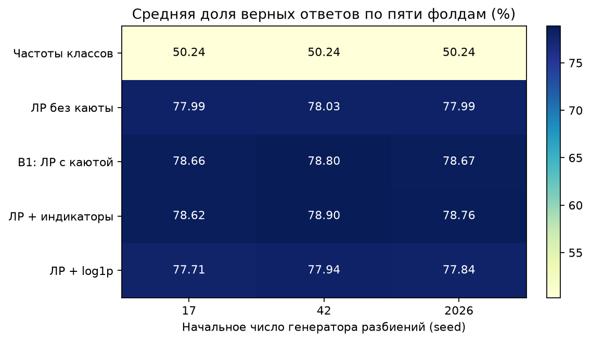
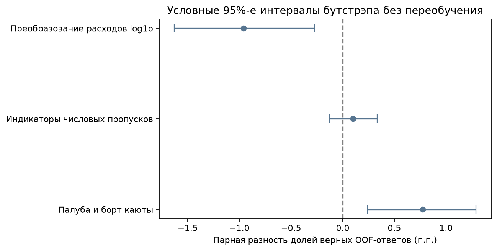
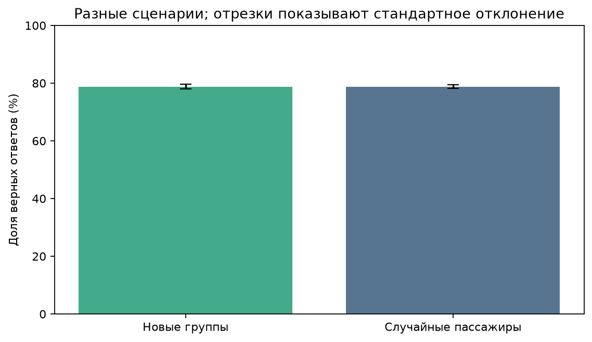
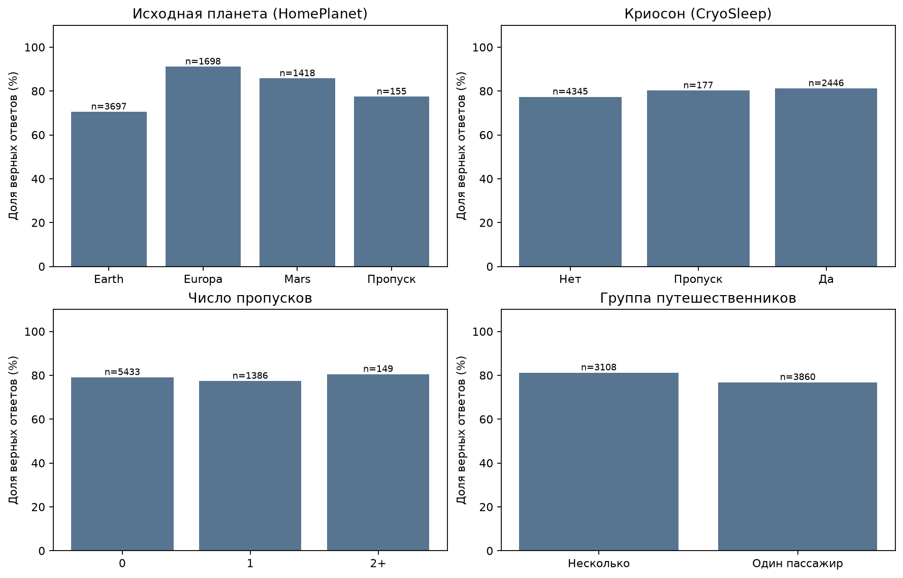
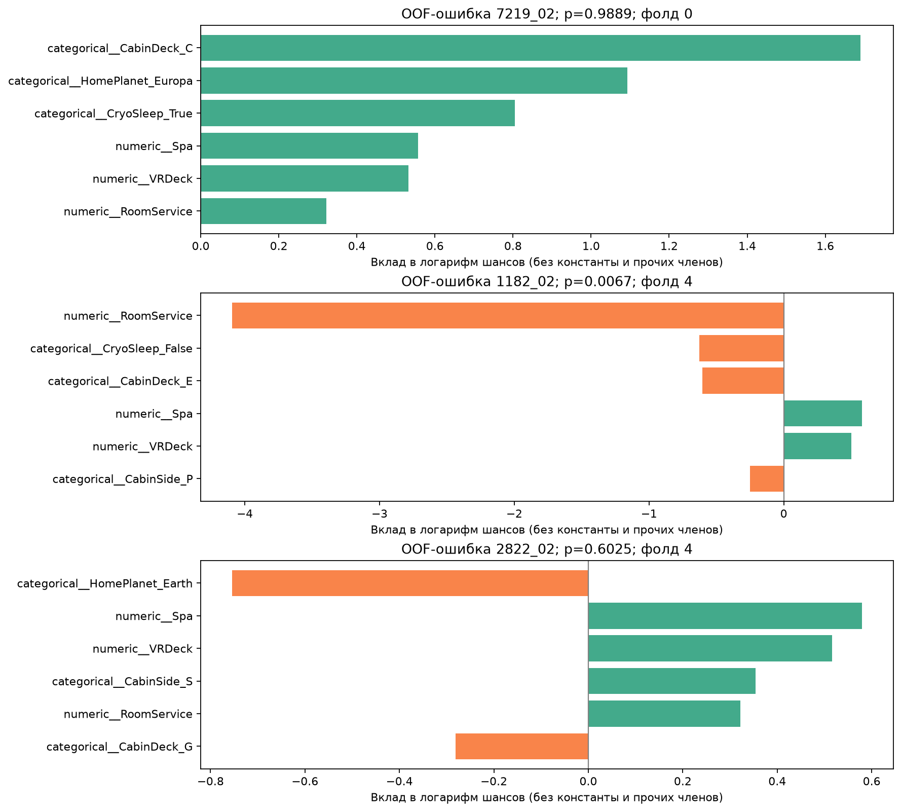

# HW1. Spaceship Titanic: воспроизводимая базовая модель

**Основной результат:** логистическая регрессия с палубой и бортом каюты получила
**{{ACCURACY}} ± {{FOLD_SD}} п.п.** на пяти групповых фолдах при `seed=42`.
Здесь accuracy означает долю верных ответов, а SD обозначает выборочное стандартное
отклонение по фолдам. Это мера разброса, а не доверительный интервал.
Окончательная отложенная выборка (final holdout) не оценивалась.

Правила проверки описаны в [фиксированном протоколе](PREREGISTRATION.md).
При разработке не использовались таблица результатов Kaggle и метки `test.csv`.

## Быстрый запуск

Требуется Python **3.12+**. Проверено на Linux x86_64 с Python {{PYTHON_VERSION}},
CPU и одним потоком вычислительной библиотеки BLAS. GPU не требуется.
Версии закреплены в `requirements.txt`.

Из корня репозитория:

```bash
python -m venv .venv
.venv/bin/python -m pip install -r requirements.txt
python scripts/download_data.py
.venv/bin/python -m pytest -q
./scripts/run_baseline.sh
python scripts/render_readme.py
```

В архиве для сдачи исходные CSV уже приложены; скрипт загрузки проверит их
контрольные суммы. Для установки без сети нужен отдельный архив
`spaceship-hw1-offline-wheels.zip` для Linux x86_64 / CPython 3.14. Распакуйте его
в родительскую папку проекта. Архив содержит `spaceship-hw1/vendor/wheels/`;
для папки `ml-rnd-spaceship-titanic` перенесите этот `vendor/wheels` в ее корень.
Затем выполните:

```bash
.venv/bin/python -m pip install --no-index --find-links vendor/wheels \
  --require-hashes -r requirements-linux-py314.lock
```

При получении проекта из Git данные скачиваются по ссылке на фиксированную
версию. Подробности: [data/README.md](../data/README.md).

Запуск выполняет 80 обучений с оценкой на соответствующем фолде, сохраняет
метрики, прогнозы для объектов, не входивших в обучение модели
(out-of-fold, OOF), девять графиков и обученную B1 для следующих работ. Записанный вызов `run_experiment` занял
{{FIT_SECONDS}} с. Время включает чтение и запись, 80 обучений с оценкой,
бутстрэп и обучение B1 на всей рабочей выборке. Построение графиков, установка
зависимостей и повторное обучение для объяснения ошибок в него не входят.

```bash
# Перестроить отчет из сохраненных прогнозов
PYTHONPATH=src .venv/bin/python -m spaceship_hw1 report
# Применить B1 к test.csv без меток; файл в Kaggle не отправляется
PYTHONPATH=src .venv/bin/python -m spaceship_hw1 predict
```

## 1. Постановка задачи и гипотеза

Предсказываем `Transported` для **одного пассажира** по доступной записи о нем.
История о пространственной аномалии задает синтетическую учебную задачу.
Практический смысл работы состоит в построении проверяемого процесса бинарной
классификации при смешанных признаках, пропусках и связанных наблюдениях.
Результаты не подтверждают пригодность модели для реальной спасательной системы.

Основной сценарий: прогноз для **новых групп путешественников**, которых не было
в обучении. Предполагается, что перечисленные поля известны при прогнозе.
В реальном процессе доступность этих сведений до события нужно было бы проверить.

**H1:** логистическая регрессия с признаками пассажира точнее модели, которая
опирается только на частоты классов. Возраст, криосон (`CryoSleep`), исходная
планета, каюта и расходы могут содержать полезную для прогноза информацию.
Критерий: положительная средняя парная разность accuracy и преимущество хотя бы
на четырех из пяти основных фолдов. Получено преимущество на
**{{HYPOTHESIS_FOLDS}}/5** фолдах. Это правило принятия решения, а не тест
статистической значимости.

## 2. Формализация

- **X:** одна строка записи. Числа: `Age`, `RoomService`, `FoodCourt`,
  `ShoppingMall`, `Spa`, `VRDeck`. Категории: `HomePlanet`, `CryoSleep`,
  `Destination`, `VIP`. Из `Cabin` извлекаются палуба и борт; номер каюты
  в B1 не используется.
- **y:** `Transported ∈ {0,1}`; задача бинарной классификации.
- **Один прогноз:** `p = P(Transported=1 | X)` и класс `1[p >= 0.5]`.
- **PassengerId:** часть до подчеркивания задает группу путешественников только
  для разбиения данных; сам идентификатор в признаки не входит.
- **Name:** исключен. Целевая переменная и метки других пассажиров не входят в X.
- При применении модели доступны те же поля без целевой переменной.
  Неизвестные категории допустимы; отсутствие обязательного столбца,
  бесконечности и отрицательные расходы вызывают ошибку.

## 3. Данные и разведочный анализ

Источник: [Kaggle Spaceship Titanic](https://www.kaggle.com/competitions/spaceship-titanic/data),
Addison Howard, Ashley Chow, Ryan Holbrook, 2022; на странице данных указана
лицензия CC BY 4.0. Размеченный CSV содержит **8693 строки, 14 столбцов**
и 6217 групп путешественников. В неразмеченном `test.csv` Kaggle 4277 строк;
этот файл не используется для локальной оценки.

Данные получены из публичной копии Hugging Face, поскольку официальная загрузка
требовала авторизации. Две публичные копии совпали побайтно; фиксированные версии
и SHA-256 записаны в [PROVENANCE.json](../data/PROVENANCE.json).
Официальные файлы Kaggle не скачивались, поэтому совпадение с их контрольной
суммой не заявляется.

До разведочного анализа по правилу, не зависящему от меток, выделена окончательная
отложенная выборка целыми группами: **{{N_HOLDOUT}} строк /
{{N_HOLDOUT_GROUPS}} групп**. Ее метки не анализируются и не используются для
обучения или оценки. Оставшаяся рабочая выборка (development) содержит
**{{N_DEV}} строк / {{N_DEV_GROUPS}} групп**; в классе 0 находится {{N_NEGATIVE}}
пассажиров, в классе 1 находится {{N_POSITIVE}}. Классы почти сбалансированы.




У расходов длинные правые хвосты и много нулей. Есть пропуски в числах и
категориях. Подробные значения: [data_audit.json](../reports/data_audit.json).
В рабочей выборке {{NUMERIC_DUPLICATES}} записей с повторяющимся набором признаков.
Они не удалялись: совпадение атрибутов не доказывает дублирование пассажира.
`PassengerId` уникален.

Риски: связанные пассажиры, признаки планеты и каюты как косвенные показатели
других свойств, неопределенность синтетического процесса генерации меток,
недостаток информации в X. Уверенная ошибка модели сама по себе не доказывает
ошибку разметки.

## 4. Базовая модель и предобработка

**B0 (`dummy_prior`).** Вероятности равны частотам классов в обучающей части
фолда; порог равен 0.5. При равенстве вероятностей выбирается класс 1.

**B1 (`logistic_cabin`).** Логистическая регрессия
`LogisticRegression(C=1, solver=lbfgs, max_iter=3000, tol=1e-4)`, порог 0.5.
Параметры зафиксированы, подбор и ансамбли не используются. Модель быстро
обучается, ее вычисления можно разобрать по вкладам признаков, поэтому она
служит точкой отсчета для следующих работ. Дополнительные варианты проверяют
отдельные изменения признаков.

Цепочка обработки: `PassengerFeatures → ColumnTransformer → classifier`.

1. Признаки вычисляются отдельно для каждой строки, без статистики соседей.
2. Числовые пропуски заполняются медианой, затем применяется `StandardScaler`.
   Параметры обоих преобразований вычисляются только на обучающей части фолда.
3. Пропуск категории заменяется на `__MISSING__`; `OneHotEncoder` создает
   отдельный двоичный признак для каждой категории и допускает новые значения.
   Набор категорий определяется только по обучающей части фолда.
4. Имя, идентификатор, целевая переменная и агрегаты чужих меток не используются.

Дополнительные варианты из фиксированной конфигурации: регрессия без каюты;
B1 с индикаторами числовых пропусков; тот же вариант с `log1p` расходов.
Они проверяют конкретные вопросы; сохранены все результаты, включая ухудшения.

## 5. Протокол оценки

Основная метрика **accuracy** совпадает с метрикой соревнования и подходит при
близком балансе классов. Для N проверочных пассажиров
`accuracy = (TP + TN) / N`: каждый пассажир имеет одинаковый вес.
F1, precision (точность положительного прогноза) и recall (полнота) описывают
ответы при заданном пороге. ROC-AUC и AP (average precision) характеризуют
ранжирование;
log loss и оценка Брайера характеризуют ошибки вероятностных прогнозов.

- Окончательная отложенная выборка: первые 64 бита
  `SHA256('spaceship-final-v1:' + group) / 2^64 < 0.20`.
  Правило не использует целевую переменную. Выборка сохранена для финала курса.
- На рабочей выборке: `StratifiedGroupKFold`, пять фолдов. Разбиение сохраняет
  группы целиком и стремится выровнять доли классов. Начальное число генератора
  (seed) равно 42 в основной оценке, 17 и 2026 в дополнительных.
  В каждом запуске модель обучается на четырех фолдах и проверяется на пятом.
  Все варианты сравниваются на одних и тех же фолдах.
- Сохранены идентификаторы, группы, роли и номера фолдов. Данные и разбиения
  проверяются по SHA-256. Неявное изменение останавливает запуск.
- У каждой строки рабочей выборки ровно один OOF-прогноз для каждой пары
  «модель, seed». Группы обучения и проверки не пересекаются.
  В таблице оценочных прогнозов нет пассажиров из окончательной отложенной выборки.
- Предобработка обучается только на обучающей части фолда. Гиперпараметры и порог
  не подбирались. Дальнейшие решения принимаются только по рабочей выборке.

В HW1 B1 служит фиксированной точкой отсчета. Более высокая точечная accuracy
варианта с индикаторами пропусков не меняет определение базовой модели.
Для HW2 до новых запусков задано правило: выбирать кандидата с максимальной
средней accuracy на пяти основных фолдах (`seed=42`), при точном равенстве
выбирать менее сложную модель. Разбиения с `seed=17/2026` проверяют устойчивость;
лучшее начальное число не выбирается. Порог остается 0.5. Изменения правила
или подбор порога нужно отдельно фиксировать и проводить на рабочей выборке.

Среднее ± выборочное стандартное отклонение пяти значений accuracy не дает
доверительного интервала. Отдельно выполнены 2000 повторов парного группового
бутстрэпа по готовым OOF-прогнозам при `seed=9187`: целые группы выбираются
с возвращением, одинаково для сравниваемых моделей. Интервалы рассчитаны по
прогнозам уже обученных моделей и не учитывают полную вариативность повторного
обучения и зависимость между пересекающимися обучающими частями.
Для трех абляций нет поправки на множественные проверки. Это описательные
результаты рабочего протокола.

## 6. Измеренные результаты

{{RESULTS_TABLE}}





Accuracy в таблице усреднена по фолдам. В `summary.json` также дана accuracy
по объединенным OOF-прогнозам, где вес фолда зависит от его размера.
Поэтому эти числа могут различаться в последних знаках. F1, AUC и log loss
рассчитаны по объединенным OOF-прогнозам. У B0 вероятности постоянны внутри
фолда, но немного различаются между фолдами; общая AUC может слегка отличаться
от 0.5.

### Исследовательские вопросы и абляции

Абляция проверяет вклад изменения при сравнении с тем же решением без него.

1. Улучшают ли палуба и борт каюты ту же регрессию на фиксированных групповых фолдах?
2. Помогают ли индикаторы числовых пропусков сверх заполнения медианой?
3. Улучшает ли `log1p` расходов ту же модель с индикаторами пропусков?
4. Как меняется оценка при случайном разбиении пассажиров вместо целых групп?

{{CONTRAST_TABLE}}



Добавление признаков каюты дало положительную наблюдаемую разность. Индикаторы
пропусков дали небольшую точечную прибавку с интервалом, включающим ноль.
`log1p` ухудшил фиксированный вариант. После логарифмирования линейная граница
в новых координатах может стать нелинейной в исходных. Более симметричное
распределение не гарантирует улучшения. Это возможное объяснение, а не доказанная
причина результата.

Отдельная перекрестная проверка со случайным разбиением пассажиров дает
**{{RANDOM_ACCURACY}}**, почти как групповая. Здесь не подтверждается завышение
accuracy случайного разбиения для данной модели. Протоколы при этом отвечают
на разные вопросы о новых объектах.



### Ошибки, срезы и интерпретация

В основных OOF-прогнозах B1 найдено **{{ERROR_COUNT}} ошибок**. Срезы построены
по `HomePlanet`, `CryoSleep`, числу пропусков и размеру группы путешественников.
Значения и размеры срезов: [slices.csv](../reports/slices.csv).



На Earth accuracy составляет около 70.54%, на Europa около 91.11%; доли
целевых классов тоже различаются. Это описательные различия, не доказательство
«влияния планеты». У одиночных пассажиров accuracy около 76.84%, у нескольких
пассажиров в группе около 81.24%. Зависимость от числа пропусков немонотонна;
срез с двумя и более пропусками содержит только 149 строк.

Ложноположительная ошибка (FP) означает прогноз 1 при истинном классе 0,
ложноотрицательная (FN) означает прогноз 0 при истинном классе 1.
Частоты по всем OOF-прогнозам рабочей выборки:

{{ERROR_TYPE_TABLE}}

Два примера с обычной для своего типа уверенностью:

{{TYPICAL_ERROR_TABLE}}

Уверенность определяется как `max(p, 1-p)`: для FP она равна p, для FN равна 1-p.
В каждом типе выбирается ошибка с уверенностью, ближайшей к медиане этого типа;
при равенстве используется `PassengerId`. Этот описательный анализ добавлен
при проверке после экспериментов и не меняет модель. Примеры характерны по
уверенности внутри FP/FN, а не по всем признакам. Полные записи и правила:
[error_analysis.json](../reports/error_analysis.json).

- `2964_01`: FP с p≈0.6443; Europa, `CryoSleep=False`, каюта A/35/S,
  возраст 26 лет. Одновременно присутствуют `FoodCourt=8525` и `RoomService=2050`;
  линейная модель дает класс 1 при истинном классе 0.
- `6763_01`: FN с p≈0.3254; Earth, `CryoSleep=False`, каюта G/1097/P,
  возраст 20 лет. Расходы преимущественно небольшие, но истинный класс равен 1.

Записи показывают ошибки в обе стороны при умеренной уверенности. Их признаки
сами по себе не устанавливают причину ошибки или ошибочность разметки.
Проверка нелинейных взаимодействий мотивирована совокупностью результатов,
но ее преимущество еще не измерено.

Отдельно сохранены три ошибки с крайними значениями уверенности или числа пропусков:

{{ERROR_TABLE}}

- `7219_02`: уверенная FP с палубой C, Europa и `CryoSleep=True`.
  В модели соответствующего фолда их вклады в логарифм шансов равны
  примерно +1.690, +1.093 и +0.804, но истинный класс равен 0.
  Положительные вклады признаков не исключают ошибку отдельного прогноза.
- `1182_02`: FN; `RoomService=2997`. Вклад стандартизированного значения
  составляет около -4.094 в логарифм шансов. Он объясняет низкую
  вероятность модели при истинном классе 1. Пример оставлен в данных;
  следующая гипотеза предполагает проверку нелинейных взаимодействий.
- `2822_02`: неверный прогноз с тремя пропусками и p≈0.6025.
  Это неполная запись, но она не доказывает общий вред пропусков.



Для каждого из трех примеров повторно обучена модель на соответствующей
фиксированной обучающей части фолда. Вероятность совпадает с OOF-прогнозом
в пределах 1e-9. Логит, то есть логарифм шансов `ln(p/(1-p))`, равен
сумме вкладов признаков и свободного члена. Все слагаемые сохранены в
[error_explanations.json](../reports/error_explanations.json). Это разложение
прогноза модели, а не объяснение причины события. По крайним случаям нельзя
оценить частоту ошибок.

## 7. Выводы и следующая гипотеза

{{CONCLUSIONS}}

## Карта требований HW1

| Требование | Где проверяется |
| --- | --- |
| Постановка и основная гипотеза (6 баллов) | Разделы 1–2, фиксированный протокол |
| Обоснованная базовая модель (5) | Раздел 4, features.py, YAML |
| Метрика и протокол (6) | Раздел 5, data/splits, тесты целостности |
| Репозиторий и инструкция (5) | Быстрый запуск, исходники, тесты, закрепленные зависимости |
| Результаты и интерпретация (3) | Разделы 6–7, разбор ошибок |
| Минимум три своих вопроса | Раздел 6: четыре проверяемых вопроса |
| Пять обязательных ответов | Что предсказывается: 1; X/y и доступные поля: 2; метрика и разбиение: 5; модель и предобработка: 4; ошибки, утечки и следующая гипотеза: 3, 6–7 |

## Воспроизводимость и дальнейшие работы

Повторный запуск в новом окружении описан в
[VERIFICATION.md](VERIFICATION.md). Команда `verify` также пересчитывает метрики
каждого фолда по таблице прогнозов и сравнивает их с сохраненными значениями.

[План следующих работ](FUTURE_HOMEWORK.md), [вопросы для защиты](DEFENSE_GUIDE.md),
[порядок сдачи](SUBMISSION_CHECKLIST.md). Каждая домашняя работа оформляется
отдельным PR в собственном репозитории. Изменения данных и протокола
нужно указывать явно.

## Источники

- [Условия HW1](https://github.com/PikaChuChuMF/RnD-ML-Course-2026-2/blob/main/HW_1/HomeWork_1.md)
- [Критерии оценки и план курса](https://github.com/PikaChuChuMF/RnD-ML-Course-2026-2/blob/main/README.md)
- [Официальные данные и поля](https://www.kaggle.com/competitions/spaceship-titanic/data)
- [Метрика соревнования](https://www.kaggle.com/competitions/spaceship-titanic/overview/evaluation)
- [Публичная копия CSV](https://huggingface.co/datasets/Hugo0133/Spaceship-Titanic),
  [независимая копия train](https://huggingface.co/datasets/StevenSch12/spaceship-titanic-train)
- [scikit-learn: цепочки обработки](https://scikit-learn.org/stable/modules/compose.html),
  [перекрестная проверка](https://scikit-learn.org/stable/modules/cross_validation.html),
  [LogisticRegression](https://scikit-learn.org/stable/modules/generated/sklearn.linear_model.LogisticRegression.html)

Чужие решения Kaggle не использовались. Библиотеки вызываются через публичные API.
